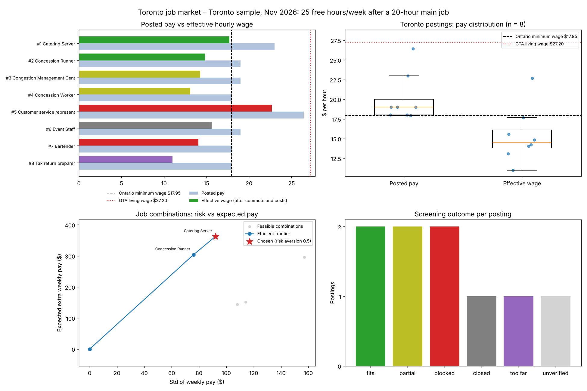
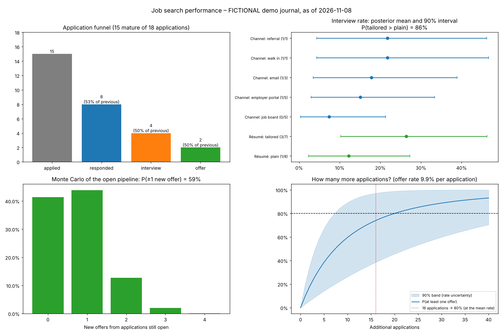

# Job Search Quant

**Author:** Marcelo Farez, Economics & Finance, Toronto Metropolitan University
**Stack:** Python, NumPy, scikit-learn, SQLite, Matplotlib

[](https://github.com/MarceloF21/quant-trading-platform/actions/workflows/ci.yml)

This started as a stock-trading backtester. Version 3 points the same quant toolkit at my own **AI-assisted part-time job search in Toronto**:
- **Job postings are the market.** They're screened, priced by what an hour of work really pays, and combined like assets.
- **Applications are the trade log.** They're measured with a funnel, Bayesian success rates and Monte Carlo odds.

| Quant toolkit | In this project |
|---|---|
| Market data | Toronto job postings, collected from employers' own hiring systems and labelled `verified` / `mirror` / `lead` / `closed` |
| Indicators and signals | Pay, hours, schedule and requirements parsed from each posting; screening against my constraints |
| Return and risk of an asset | **Effective hourly wage** (after unpaid commuting and one-off costs), and the uncertainty of casual hours |
| Portfolio optimization | The best combination of jobs for the hours left after my main job, with a mean–variance **efficient frontier** |
| Trade log and backtest | **Applications journal**: response, interview and offer funnel |
| Statistical inference | **Bayesian Beta–Binomial** success rates by channel and résumé version, plus a Bayesian A/B test |
| Monte Carlo | Odds of a new offer from the open pipeline, and **how many more applications** give 80% odds of an offer |
| Benchmarks | Ontario minimum wage ($17.95, Oct 2026) and the GTA living wage ($27.20, 2025) |

## 1. The Toronto market: real postings, November 2026

These are nine public postings checked November 5–8, 2026, including event venues, a traffic operations centre, a tax office and a call centre. The profile is a fictional student:
- A 20-hour main job, with 25 free hours a week.
- No car and no Smart Serve certificate.
- Not available at night.
- Values free time at minimum wage.

**Findings**
1. **Posted pay overstates what an hour of work is worth.**
   - Every priced posting pays at least the $17.95 minimum wage, but after unpaid commuting only **12%** still do.
   - The median drops from **$19.00 posted to $14.54 effective**: $4.66/hour goes to travel and setup costs.
   - None reaches the **$27.20 GTA living wage**.
2. **The best-paying job isn't the best hourly deal.** The $23/hour catering job is worth **$17.68/hour** once about 4.5 weekly commuting hours and the Smart Serve course are counted, which is still the best on the list.
3. **Screening removes most of the market.** Of nine postings:
   - Two need French or six months of bartending.
   - One is a 95-minute commute.
   - One had closed.
   - One was only a search snippet.
4. **Portfolio choice.** Maximizing expected pay with risk aversion 0.5 picks the catering job: **$362 ± $92 a week** for 20.5 hours including travel. Valuing free time at minimum wage (`--objective surplus`), no extra job adds value.



## 2. Search performance: applications journal (demo data is fictional)

> The journal shown here is **fictional**, with made-up employers. It demonstrates the method, not a result. My real journal stays private in the git-ignored `data/` folder.

From 18 demo applications (15 mature: answered, closed, or past the 21-day response window):
- **Funnel:** 15 applied → 8 responses → 4 interviews → 2 offers. Median first reply after 6.5 days.
- **Bayesian rates:** with weak priors, the interview rate is **22%** (90% interval 9–37%) and the offer rate after an interview is **46%** (20–72%). The wide intervals are the honest answer from 15 data points.
- **A/B test:** tailored résumés got interviews 3/7 times vs 1/8 for plain ones. That gives **P(tailored is better) = 86%**: promising, not proven.
- **Monte Carlo** (20,000 runs): the four open applications give a **59%** chance of at least one new offer.
- **Plan:** at about a 9.9% offer rate per application, **16 more applications** give 80% odds of at least one offer.



## How it works

- **Effective wage** = (expected weekly pay − weekly share of one-off costs) ÷ (paid hours + unpaid commute hours).
  - Expected hours come from the posting.
  - When a posting doesn't say, casual, part-time and full-time defaults apply, each with a standard deviation, and every assumption is reported.
  - Certificate costs (dollars plus time valued at the reservation wage) are spread over a 20-week horizon.
- **Surplus** = net weekly pay − reservation wage × total weekly time. It's negative when a job pays less than the free time it takes.
- **Portfolio:**
  - Expected pay adds up across jobs, and risk adds in quadrature (hours treated as independent).
  - Every combination must fit the time budget.
  - The chosen combination maximizes `E[pay or surplus] − λ·σ`.
- **Bayesian rates:**
  - Each rate has a Beta prior that's deliberately weak: 8 pseudo-applications for response (25%) and interview (12%), and 6 for offer-after-interview (35%).
  - Each prior is updated with mature applications only, so recent applications don't count as failures.
  - The 90% intervals and P(A > B) come from posterior samples.
- **Monte Carlo:**
  - Each run draws the rates from their posteriors, so uncertainty about the rates themselves is included.
  - Then every open application succeeds or fails.
  - The "applications needed" curve is `P(≥1 offer) = 1 − (1 − p)^n`, averaged over the posterior.
- **Sources:** documented public employer feeds, labelled `verified`:
  - The Greenhouse Job Board API.
  - The Lever Postings API.
  - Oracle Recruiting Cloud's `recruitingCEJobRequisitionDetails`.

  Anything else is imported from CSV as a `mirror` (job board) or `lead` (search snippet). Postings past their closing date become `closed`, and the tool never scrapes sites that block automated access.
- **AI-assisted workflow:**
  - I use an AI assistant to find and verify postings and to tailor each résumé to its posting.
  - This platform measures whether that works: the résumé-version A/B test, response rates by channel, and the keyword matcher.
  - The keyword matcher compares résumé and posting wording with TF-IDF cosine similarity and lists the posting's key phrases the résumé never uses.

## Quick start

```bash
pip install -r requirements.txt
python -m job_search_quant demo                              # everything above → output/demo

python -m job_search_quant import my_postings.csv            # or: fetch greenhouse <board> | fetch lever <company>
                                                             #     | fetch oracle <host> --site CX_1 --job-id 45153
python -m job_search_quant market --profile my_profile.json --objective pay --risk-aversion 0.5
python -m job_search_quant search --journal data/applications.csv          # your private journal
python -m job_search_quant match --resume resume.txt --posting-id ovg-35161
```

**Journal format** (`data/applications.csv`, the same columns as `examples/sample_applications.csv`):

| Column | Contents |
|---|---|
| `id`, `employer`, `title` | Identify the application |
| `category` | Kind of job, e.g. `events_hospitality`, `operations` |
| `channel` | `employer_portal`, `email`, `job_board`, `walk_in` or `referral` |
| `applied` | Date applied (YYYY-MM-DD) |
| `resume_version` | e.g. `plain`, `tailored` |
| `responded`, `interview`, `offer` | Date each stage was reached, or blank |
| `outcome` | `open`, `rejected`, `no_response`, `withdrawn`, `accepted` or `declined` |
| `hourly_wage`, `expected_hours` | Pay and hours, if known |
| `posting_id` | Link to a stored posting (optional) |

## Tests

```bash
pip install -r requirements-dev.txt
ruff check . && pytest
```

The 47 tests cover:
- **Parsing:** pay formats, bi-weekly hours, and required vs "asset" requirements.
- **Economics:** effective wage, cost amortization and every screening rule.
- **Optimizer:** the time budget, risk aversion and frontier dominance.
- **Journal:** maturity and funnel counts.
- **Bayesian rates:** posteriors against the closed form, and intervals narrowing as data grows.
- **Planning and simulation:** applications-needed arithmetic and Monte Carlo bounds.
- **Market:** benchmark shares.
- **Data sources and runs:** mocked Greenhouse, Lever and Oracle feeds, the database round trip, and the full demo.

GitHub Actions runs them on Python 3.10, 3.12 and 3.13.

## Project structure

```
job_search_quant/
  sources.py     employer feeds (Greenhouse, Lever, Oracle), CSV import, closing dates
  parse.py       pay, hours, schedule, requirements, tips from posting text
  economics.py   screening, expected hours, effective wage, surplus
  optimizer.py   job combinations, efficient frontier, risk-adjusted choice
  market.py      pay distribution vs benchmarks          benchmarks.py  minimum and living wage
  journal.py     applications journal and funnel         odds.py        Bayesian rates and A/B test
  simulate.py    Monte Carlo pipeline and applications-needed curve
  match.py       résumé vs posting keywords              report.py      tables, files, dashboards
  db.py          SQLite storage                          cli.py         fetch, import, market, search, match, demo
examples/        real public Toronto postings, plus fictional profile, journal and résumé
tests/           pytest suite
```

## Limitations

- **Small sample:** nine postings describe this search, not Toronto's labour market as a whole.
- **Assumed hours:** hours for casual and event jobs are assumptions when they aren't posted (flagged).
- **Estimated commutes:** commute times are your own estimates, with no transit routing.
- **Simplified scheduling:** hours are treated as independent across jobs, and availability is matched by time window, not by individual shift.
- **Gross pay:** pay is before tax, and tips aren't counted.
- **Assumed priors:** the Bayesian priors are assumptions, and with a few dozen applications they still shape the answer. Change them in `odds.py`.
- **Heuristic parsing:** check key fields against the posting.
- **Earlier versions:** versions 1–2 were a stock backtester, still in the git history. The repository name predates version 3.
