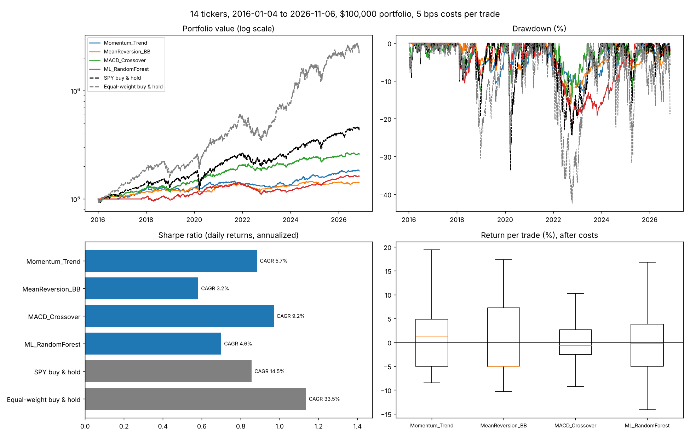

# Quantitative Trading Platform

**Author:** Marcelo Farez · **Stack:** Python, pandas, NumPy, scikit-learn, SQLite, Matplotlib

[](https://github.com/MarceloF21/quant-trading-platform/actions/workflows/ci.yml)

A backtesting platform that tests four strategies on 14 US stocks and ETFs:
1. Trend-following momentum.
2. Bollinger Band mean reversion.
3. MACD crossover.
4. A walk-forward random forest.

Every strategy trades one shared $100,000 portfolio, with trading costs, next-day execution and intraday stop-losses, and is compared with simply buying SPY.

## Results: real prices, January 2016 – November 2026

| Strategy | CAGR | Sharpe | Sortino | Max drawdown | Calmar | Trades | Win rate | Avg. invested |
|---|---:|---:|---:|---:|---:|---:|---:|---:|
| Momentum_Trend | 5.7% | 0.88 | 1.25 | -12.7% | 0.45 | 682 | 58.2% | 41.0% |
| MeanReversion_BB | 3.2% | 0.58 | 0.82 | -16.2% | 0.20 | 304 | 48.7% | 25.3% |
| MACD_Crossover | 9.2% | 0.97 | 1.39 | -14.3% | 0.64 | 1,503 | 41.4% | 61.7% |
| ML_RandomForest | 4.6% | 0.70 | 0.96 | -22.6% | 0.20 | 695 | 48.9% | 39.0% |
| SPY buy & hold | 14.5% | 0.86 | 1.20 | -33.7% | 0.43 | – | – | – |
| Equal-weight buy & hold | 33.5% | 1.13 | 1.68 | -42.4% | 0.79 | – | – | – |

All figures are after 5 bps trading costs per side, on 2,728 trading days of split- and dividend-adjusted Yahoo Finance data. The risk-free rate is 0. Rerun with `python -m quant_trading_platform backtest`.

**What the results say**
1. **No strategy beat SPY's 14.5% annual return, but MACD and Momentum had better risk-adjusted returns.** Their Sharpe ratios (0.97 and 0.88) beat SPY's 0.86, and their worst drawdowns (−14% and −13%) were less than half of SPY's (−34%). They're in cash much of the time, which cuts both losses and gains.
2. **The machine-learning model has no real predictive edge.** Out of sample, it called the next day's direction correctly **51.7%** of the time across 31,864 predictions. Always guessing "up" scores **53.1%**. Its returns come from being partly invested, not from forecasting skill.
3. **Equal-weight buy-and-hold (33.5% a year) is inflated by hindsight.** The 14 tickers include NVDA, picked after its rise. That selection bias applies to every strategy here, which is why SPY is the fairer benchmark.



## How the backtest works

- **Data:** daily open/high/low/close/volume bars from Yahoo Finance (via `yfinance`), adjusted for splits and dividends and stored in SQLite. Price data isn't committed; `fetch` downloads it.
- **No look-ahead:** signals use data up to each day's close, and trades fill at the **next day's open**. A test confirms that adding future prices never changes past signals.
- **Costs:** 5 bps per side for commission and slippage, applied to every fill.
- **One portfolio:** a single $100,000 account. Each new position gets 10% of equity, with at most 10 positions, long-only and no leverage.
- **Risk exits:** 5% stop-loss and 15% take-profit, checked against each day's low and high.
  - A gap through the level fills at the open.
  - If both are hit the same day, the stop is assumed to come first.
  - After an exit, a ticker re-enters only on a fresh signal.
- **Metrics:** computed from the **daily equity curve**: CAGR, volatility, Sharpe and Sortino (daily returns × √252), max drawdown, Calmar, win rate and profit factor.
- **Walk-forward ML:** a random forest (50 trees, depth 5) on 12 technical features predicts whether tomorrow closes higher.
  - It's trained on the first 252 days, then retrained every 63 days on all past data. No prediction ever comes from a model trained on its own future.
  - It buys when P(up) > 0.55 and exits when P(up) < 0.45.

## Strategies

| Strategy | Enter when | Exit when |
|---|---|---|
| Momentum_Trend | Price > 50-day SMA > 200-day SMA, 20-day momentum > 2%, RSI < 70 | RSI > 75 |
| MeanReversion_BB | Price in the bottom 10% of the Bollinger Bands and RSI < 30 | Top 10% of the bands and RSI > 70 |
| MACD_Crossover | MACD crosses above its signal line | MACD crosses below its signal line |
| ML_RandomForest | Model's P(next day up) > 0.55 | P(next day up) < 0.45 |

All strategies also use the stop-loss and take-profit above.

## Quick start

```bash
pip install -r requirements.txt
python -m quant_trading_platform fetch      # download 2016–today prices into data/market_data.db
python -m quant_trading_platform backtest   # run all strategies; writes output/results.md, results.json,
                                            # equity.csv, trades.csv and dashboard.png
python -m quant_trading_platform demo       # offline run on simulated prices (clearly labelled)
```

Useful options:
- `--start 2020-01-01` / `--end 2025-12-31`: date range.
- `--tickers AAPL MSFT SPY`: choose tickers.
- `--cost-bps 10`, `--position-size 0.05`, `--max-positions 5`, `--stop-loss 0.08`, `--take-profit 0.2`: portfolio and cost settings.
- `--no-ml`: skip the slower ML strategy.
- `--write-db`: also store trades and metrics in SQLite.

## Tests

```bash
pip install -r requirements-dev.txt
ruff check . && pytest
```

The 20 tests check:
- Exact trade P&L.
- Costs on both sides.
- Stop-loss fills (including gaps) and take-profit.
- The shared account and position cap.
- That no strategy uses future data, including the ML model.
- The metric formulas.
- Full command-line runs.

GitHub Actions runs them on Python 3.10, 3.12 and 3.13.

## Project structure

```
quant_trading_platform/
  config.py       portfolio and cost settings
  data.py         SQLite storage, Yahoo Finance download, simulated prices for tests
  indicators.py   SMA/EMA, RSI, MACD, Bollinger Bands, volatility, momentum
  strategies.py   the four strategies
  backtest.py     portfolio engine and buy-and-hold benchmark
  metrics.py      performance and trade statistics
  pipeline.py     runs all strategies and benchmarks
  report.py       results table, files, dashboard chart
  cli.py          `fetch`, `backtest` and `demo` commands
tests/            pytest suite
```

## Limitations

- **Hindsight universe:** today's well-known tickers were chosen after the fact (survivorship and selection bias).
- **Daily bars only:** the true order of intraday highs and lows is unknown, so the stop-first assumption is conservative.
- **Simplified costs:** a flat 5 bps, no taxes, no market impact for larger orders.
- **Standard parameters:** the strategy settings are textbook defaults, not optimized. Only the ML model is validated walk-forward.
- **Research only:** Yahoo data can contain errors. This is a research project, not trading advice or a live trading system.

## Version 2

Version 1 reported a Sharpe ratio of 7.3 and $332K profit on $100K. Those figures came from five problems:
1. The prices were simulated.
2. The Sharpe ratio annualized per-trade returns as if each trade lasted one day.
3. Profits were summed across 14 separate $100K accounts.
4. There were no trading costs, and trades filled on the signal's own bar.
5. The model was trained only once.

Version 2 rebuilt the engine to fix all five, added tests and CI, and reports results next to buy-and-hold benchmarks.

Contact: marcelodavid1404@gmail.com · GitHub: [MarceloF21/quant-trading-platform](https://github.com/MarceloF21/quant-trading-platform)
