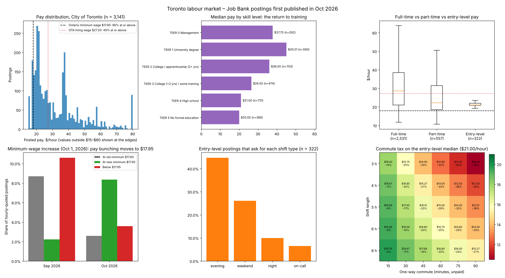

# Job Search Quant

**Quant-style analysis of a student's job search in Toronto.** Official labour-market data, effective-wage pricing, portfolio choice, Bayesian success rates and Monte Carlo, applied to a real problem: which part-time jobs are actually worth taking alongside a main job and a degree.

**Author:** Marcelo Farez, Economics & Finance, Toronto Metropolitan University
**Stack:** Python, NumPy, scikit-learn, SQLite, Matplotlib

[](https://github.com/MarceloF21/quant-trading-platform/actions/workflows/ci.yml)


## At a glance

| | Finding | Evidence |
|---|---|---|
| 💵 | **The minimum-wage increase showed up in job ads within a month.** Toronto postings advertising exactly the old $17.60 fell from 8.7% to 2.6% of hourly ads, and postings at the new $17.95 rose from 2.2% to 8.3%. 3.6% of October postings still advertised less than the new minimum. | 4,774 hourly-quoted Job Bank postings, September–October 2026 |
| 🎓 | **Training pays.** Median posted pay rises from $20.00 (no formal education) and $21.00 (high school) to $36.00 (college) and $45.01 (university). | 3,141 priced Toronto postings, October 2026 |
| 🚇 | **Commuting is a hidden pay cut.** On the $21.00 entry-level median, a 6-hour shift with a 45-minute commute each way pays **$16.80 per hour of time spent**, 20% less than posted. | Effective-wage model on official data |
| 🌙 | **Entry-level work happens at night and on weekends.** 45% of entry-level postings ask for evenings, 26% for weekends and 10% for nights. | 322 entry-level postings |
| 📈 | **The best posted rate isn't the best deal.** A $23/hour catering job is worth $17.68/hour in practice, yet it still tops my shortlist of 9 real postings. | Shortlist case study |

## 1. Toronto's labour market: official open data

This uses every posting first published on the Government of Canada's Job Bank in the City of Toronto in September and October 2026 (October: **3,168 postings, 3,894 vacancies**), from the [official open dataset](https://open.canada.ca/data/dataset/ea639e28-c0fc-48bf-b5dd-b8899bd43072).

| October 2026, City of Toronto | Value |
|---|---|
| Median posted pay (IQR) | **$26.95**/hour ($20.85–$38.00) |
| At or above the Ontario minimum wage ($17.95) | 96% |
| At or above the GTA living wage ($27.20) | 49% |
| Part-time vs full-time median | $22.19 (n = 557) vs $28.56 (n = 2,531): part-time pays 22% less |
| Entry-level median (high school or less, under a year of experience) | $21.00 (n = 322) |

| Skill level (NOC 2021 TEER) | Median pay | Postings |
|---|---:|---:|
| TEER 5: no formal education | $20.00 | 366 |
| TEER 4: high school | $21.00 | 731 |
| TEER 3: under 2 years of college or training | $26.50 | 474 |
| TEER 2: college or apprenticeship of 2 years or more | $36.00 | 703 |
| TEER 1: university degree | $45.01 | 590 |
| TEER 0: management | $37.75 | 262 |

**Natural experiment: Ontario raised its minimum wage from $17.60 to $17.95 on October 1, 2026.**

| Postings first published in | Hourly-quoted | At $17.60 (old minimum) | At $17.95 (new minimum) | Below $17.95 |
|---|---:|---:|---:|---:|
| September 2026 | 2,378 | 207 (8.7%) | 53 (2.2%) | 252 (10.6%) |
| October 2026 | 2,396 | 62 (2.6%) | 200 (8.3%) | 86 (3.6%) |

The cluster of ads at the minimum moved to the new rate almost at once, a textbook case of a binding wage floor. The 62 October ads still showing $17.60 suggest stale templates or non-compliance, worth checking before applying.



## 2. Pricing my shortlist: nine real postings

Effective hourly wage:

`effective wage = (expected weekly pay − weekly share of one-off costs) ÷ (paid hours + unpaid commute hours)`

Each posting is screened against a student profile (no car, no night shifts, a 75-minute commute limit, current certificates) and labelled by source: `verified` (employer's own site), `mirror` (job board), `lead` (snippet) or `closed`. Jobs are then combined like assets: expected pay adds up, hour uncertainty adds in quadrature, and everything must fit the 25 hours left after a 20-hour main job.

- Commuting and certificate costs cut the median shortlist wage from $19.00 posted to **$14.54** effective.
- The $23/hour catering job is the best option at **$17.68/hour** effective, or **$362 ± $92 a week** for 20.5 hours. The chosen point on the efficient frontier has risk aversion λ = 0.5.
- Five of the nine postings are screened out: French required, bartending experience required, a 95-minute commute, closed, and unverified.


## 3. Measuring the search: applications journal

> The journal shown here is **fictional**, with made-up employers. It demonstrates the method. My real journal stays in the git-ignored `data/` folder.

Applications are treated as a trade log:
- A maturity-aware **funnel**: silence counts as no response only after 21 days.
- **Beta–Binomial** success rates by channel and résumé version.
- A **Bayesian A/B test**.
- A **Monte Carlo** of the open pipeline.
- The number of further applications needed for **80% odds** of an offer.

On the demo journal of 18 applications:
- The interview rate is 22% (90% interval 9–37%).
- P(tailored résumé beats plain) = 86%.
- There's a 59% chance of a new offer from the open applications.
- 16 more applications reach 80% odds.


## What the data says to do

1. **Value a job by its effective wage, not its posted wage.** On short shifts the commute dominates: a 4-hour shift with a 45-minute commute each way loses 27% of its value.
2. **Train up one level.** The jump from TEER 4 ($21.00) to TEER 3 ($26.50) is +26%, often reachable with a short certificate or college credential. A finished degree (TEER 1) is worth more than double the entry rate.
3. **Show evening and weekend availability.** Nearly half of entry-level employers ask for evenings.
4. **Screen pay against the legal minimum.** One in 28 October ads advertised less than $17.95.
5. **Apply in volume, and measure.** If each application has about a 10% chance of an offer, 80% odds need around 16 applications (1 − 0.9¹⁶ ≈ 0.81). The journal estimates your own rate, and tracking channels and résumé versions shows where the next application should go.

## How it works

| Quant idea | Here |
|---|---|
| Market data | Job Bank open data (monthly CSVs) and employer job feeds: the Greenhouse, Lever and Oracle Recruiting Cloud APIs, all documented and public |
| Features | Pay, hours, schedule and requirements parsed from posting text, telling "required" apart from "asset" |
| Return and risk | Effective hourly wage, and the standard deviation of casual hours |
| Portfolio | Every feasible job combination under a time budget; efficient frontier; `E[pay or surplus] − λσ` |
| Inference | Beta–Binomial posteriors with weak, stated priors; 90% credible intervals; P(A > B) |
| Simulation | 20,000-run Monte Carlo, drawing the rates from their posteriors |
| Benchmarks | Ontario minimum wage ($17.95, from Oct 1, 2026) and GTA living wage ($27.20, 2025) |

Data handling, conversions and licences are documented in [DATA.md](DATA.md).

## Quick start

```bash
pip install -r requirements.txt

python -m job_search_quant labour --months 2026-09 2026-10   # downloads official data (~50 MB/month) → output/
python -m job_search_quant demo                              # shortlist + search analytics on the bundled examples

python -m job_search_quant import my_postings.csv            # or: fetch greenhouse <board> | fetch lever <company>
                                                             #     | fetch oracle <host> --site CX_1 --job-id 45153
python -m job_search_quant market --profile my_profile.json --objective pay --risk-aversion 0.5
python -m job_search_quant search --journal data/applications.csv      # your private journal
python -m job_search_quant match --resume resume.txt --posting-id ovg-35161
```

**Journal columns** (`data/applications.csv`; see `examples/sample_applications.csv`):

| Column | Contents |
|---|---|
| `id`, `employer`, `title` | Identify the application |
| `category` | Kind of job |
| `channel` | `employer_portal`, `email`, `job_board`, `walk_in` or `referral` |
| `applied` | Date applied (YYYY-MM-DD) |
| `resume_version` | e.g. `plain`, `tailored` |
| `responded`, `interview`, `offer` | Date each stage was reached, or blank |
| `outcome` | `open`, `rejected`, `no_response`, `withdrawn`, `accepted` or `declined` |
| `hourly_wage`, `expected_hours` | Pay and hours, if known |
| `posting_id` | Link to a stored posting (optional) |

## Tests

```bash
pip install -r requirements-dev.txt
ruff check . && pytest
```

The 57 tests cover:
- **Open-data parsing:** UTF-16 files, hourly conversion, the City of Toronto filter, summaries, minimum-wage bunching, the commute tax, and picking the right month's file.
- **Posting parsing and economics:** screening, effective wage and cost amortization.
- **Optimizer:** the frontier and risk aversion.
- **Journal:** the funnel and maturity rules.
- **Bayesian rates:** posteriors against the closed form.
- **Monte Carlo:** simulation bounds.
- **Data sources and runs:** mocked employer feeds and full command-line runs.

GitHub Actions runs them on Python 3.10, 3.12 and 3.13.

## Project structure

```
job_search_quant/
  labour.py          Job Bank open data: download, Toronto filter, pay, bunching, commute tax
  labour_report.py   labour-market tables and dashboard
  sources.py         employer feeds (Greenhouse, Lever, Oracle), CSV import, closing dates
  parse.py           pay, hours, schedule, requirements from posting text
  economics.py       screening, expected hours, effective wage, surplus
  optimizer.py       job combinations, efficient frontier, risk-adjusted choice
  market.py          shortlist pay distribution vs benchmarks      benchmarks.py  minimum and living wage
  journal.py         applications journal and funnel               odds.py        Bayesian rates and A/B test
  simulate.py        Monte Carlo pipeline and applications-needed curve
  match.py           résumé vs posting keywords                    report.py      shortlist and search dashboards
  db.py              SQLite storage                                cli.py         labour, market, search, match, demo
docs/                dashboards and committed October 2026 aggregates
examples/            real public shortlist postings; fictional profile, journal and résumé
tests/               pytest suite
```

## Limitations

- **Job Bank isn't the whole market.** Employers hiring temporary foreign workers must advertise there, which over-represents some occupations (home child care providers are October's most common). External postings carry fewer details, so entry-level figures use Job Bank's own postings.
- **Pay is as advertised,** not as paid. It's gross, and tips aren't counted.
- **Some pay figures are converted:** annual and daily pay become hourly using stated or default hours (40 a week, 8 a day). Details are in [DATA.md](DATA.md).
- **The shortlist analysis rests on my own commute estimates** and assumed hours for casual work, all flagged. The commute-tax grid shows how the results move with them.
- **The priors are assumptions.** With few applications they matter, and they can be changed in `odds.py`.
- **History:** versions 1–2 of this repository were a stock backtester, still in the git history. The repository name predates version 3.

Contains information licensed under the Open Government Licence – Canada. Code under the [MIT licence](LICENSE).
